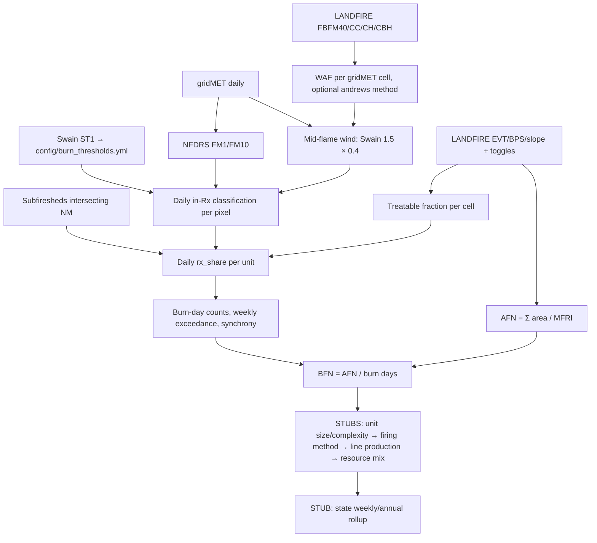

# WUS_RxResourceNeeds
Modeling the resources (personnel, quals, and equipment) needed to restore low-intensity wildfire regimes in the western United States.

> **Status (2026-11-05):** the Burn Day Model, target area, and annual Rx target (AFN/BFN) are implemented and have been run for New Mexico, 1979–2025. The unit size/complexity, firing method, line production, resource mix, and state rollup stages are **wired-in stubs with placeholder parameters**: they run end to end but their numbers are not estimates. See the [status table](#status). [`spatialanalysis_pseudocode.md`](spatialanalysis_pseudocode.md) is the statement of project intent.

## To do

**Review modeling decisions**
- [x] Live fuel moisture for rate of spread set to **L2** (herbaceous two-thirds cured: 60% herbaceous, 90% woody; `fire_behavior.live_default`). Rationale and sensitivity: [Why L2 live fuel moisture](#why-l2-live-fuel-moisture). Optional refinement: a season-dependent choice (L1 Nov-Mar, L2 Apr-Jun and Oct, L4 Jul-Sep).
- [x] Replace EVT name patterns with reviewed BPS/EVT crosswalks (`config/treatable_bps.csv`, `config/treatable_evt_phys.csv`).
- [x] Spot-check the 13 treatable BPS classes and the excluded forest classes in `config/treatable_bps.csv` (e.g. aspen and mesic mixed conifer, whose FRG varies by map zone).
- [x] Use Swain ST1 Forest Plans thresholds for now (`thresholds.plan_set: forest`). Possible later refinements: sensitivity runs with `all`/`nonforest`, vegetation-dependent thresholds (forest bounds on tree pixels, non-forest on current shrub/grass), or NM-only medians from Swain's burn-plan repository.
- [x] Mid-flame wind follows Swain et al. 2023 exactly (daily-mean 10 m wind × 1.5 × 0.4; `wind.method: swain`). Andrews WAFs remain available as `wind.method: andrews`.
- [x] Unit burn day = at least 441 treatable acres in prescription (one minimum-size burn unit; `rollup.burn_day_rule: acres`). The share rule remains available as `burn_day_rule: share`.

**Add missing data layers**
- [x] Exclude designated wilderness from planned Rx (wilderness.net NWPS boundaries, Nov 2024; `target_area.wilderness`).
- [ ] Decide whether BLM Wilderness Study Areas should also be excluded (needs the BLM WSA layer).
- [x] WUI from Community Wildfire Risk Reduction Zones (Direct + Indirect Exposure + all Wildfire Transmission Zone classes); per-unit `wui_share` replaces the statewide placeholder.

**Calibrate downstream stages** (placeholders in `config/downstream_params.yml`)

Data and method decisions so far:
- Landowner: PAD-US 4.1 (USGS), chosen so the same layer scales to the western US. PAD-US has no explicit private class, so private land is derived as the area not covered by PAD-US Fee (ownership) polygons, plus any Fee polygons with a private or nonprofit owner type. The BLM surface management agency layer for New Mexico is the fallback if the derived class proves unreliable.
- Roads: OpenStreetMap (not TIGER or Forest Service roads).
- Past burns: TWIGS Treatment Index (`https://gis.reshapewildfire.org/arcgis/rest/services/Hosted/Treatment_Index_View/FeatureServer/0`). It has polygons with acres, date, agency, activity and method, but no crew or resource fields, so it can inform unit sizes, timing, and annual accomplished acres, not the resource mix. Filter to broadcast burning (not pile burning or treatments burned in wildfire) and clean the date field, which has impossible values.
- Complexity class cutoffs: to be recommended when the complexity model is built, with the resulting class distribution shown for review.

To do:
- [x] Unit sizes from real treatable patches, split by landowner (PAD-US 4.1) and WUI, with TWIGS comparison. Each patch pool is split into equal units under the size cap. **Next:** replace equal splitting with a true size *distribution* — TWIGS shows NM burns have a long small-burn tail (median 97 ac) plus large burns (71% of acres in units > 2000 ac) that equal splitting can't reproduce.
- [ ] Split patches by flame length class as well as landowner and WUI (patches now carry acres by flame length class, but are not yet split by it).
- [x] Fire behavior: rate of spread and flame length under cool, mid and hot prescription conditions, modelled aspatially (Rothermel) and joined to the fuel model map. **Next:** decide the live moisture scenario (above); optionally add a season-dependent version.
- [ ] Unit complexity model: rate of spread, slope, aspect and fuel homogeneity, distance to OpenStreetMap roads, adjacent fuels, WUI; recommend low/medium/high cutoffs.
- [ ] Line production (chains/hr): rate of spread by patch is now available (head fire, cool and hot); turn it into line production needed and use it in the resource mix (the stub value is computed but not yet used).
- [ ] Firing method rules for hand, drone, and heli ignition (currently a simple placeholder model; hand crews do up to about 200 ac/day).
- [ ] Explore firing production per firing crew member (and the right terminology for it) in more detail later; for now a simple placeholder firing production model is used.
- [ ] Resources per unit-day across firing, holding, and contingency (needs real burn plans or expert input).
- [ ] Replace the even-spread rollup with a simple scheduling model of when burns happen against burn windows.
- [ ] Validate downstream estimates (acres, unit sizes, firing method, crews used) against a few anecdotal burn plans or realized burns.

**Model improvements**
- [ ] Ignition component threshold (needs the full NFDRS spread component).
- [ ] Bias-correct gridMET against RAWS (Barros et al. 2021).
- [ ] Better NFDRS state-of-weather adjustment than the srad approximation.

**Open questions from the pseudocode**
- [ ] **Timing mismatch between modelled burn days and observed burns (logged, unresolved).** The burn-day model puts 37% of burn days in Jul-Sep and 34% in Dec-Mar, but 84% of actual Forest Service burned acres in NM fall in Apr-Jun and Oct-Nov (TWIGS). See [Known discrepancies](#known-discrepancies-between-modelled-and-observed-burning). To investigate: whether a monsoon/green-up screen, a snow or fuel-condition screen, or other constraints should be added to the burn-day definition; and whether observed timing mainly reflects staffing and smoke management.
- [ ] Validate predicted burn windows against other observed Rx burns (WildCAD, burn plans), beyond the TWIGS seasonality comparison.
- [ ] Investigate whether managed wildfire (wildfire managed for resource objectives, e.g. Gila and Aldo Leopold wilderness) competes with planned Rx for the same people and equipment. Questions: does managed-wildfire season overlap the burn windows predicted here; how many resources does it tie up; and how much of the dry-forest fire need (including the ~284k treatable ac in wilderness excluded from this planned-Rx estimate) does it meet?
- [ ] Extend from the NM pilot to the western US.

## Goal and pilot scope

For each Fireshed Registry unit, estimate how much prescribed (Rx) fire is needed, how many days per year are burnable, how large and complex the burn units are, how they would be ignited and held, and what people, quals, and equipment that requires. Unit needs roll up to the state by week and year, accounting for burn-window **synchrony** (whether places are burnable at the same time) and year-to-year variability.

**Pilot:** New Mexico. Analysis units are the 3,157 Fireshed Registry 4th-edition **subfiresheds** (~25k ac) that intersect NM, kept whole (3,014 NM, plus 143 in AZ/CO/TX/OK). The 4th edition replaced the earlier "project area" layer with subfiresheds; the code calls them `project_id`.

## Repository structure

```
WUS_RxResourceNeeds/
├── _targets.R            # targets pipeline (run with targets::tar_make())
├── R/                    # pipeline functions, one file per stage
├── config/               # all parameters (YAML/CSV), see below
├── tests/                # testthat unit tests; run_tests.R runner
├── tools/                # optional parallel prefetch scripts (LANDFIRE, gridMET)
├── data/raw/             # downloads (git-ignored)
├── data/processed/       # intermediate products (git-ignored)
├── results/figures/      # PNG figures
├── results/tables/       # CSV tables
├── docs/                 # report (report.Rmd -> report.md), run notes, references
├── renv.lock             # pinned package versions
└── scripts/              # LEGACY empty numbered scripts, superseded by R/ + _targets.R
```

## Setup and running

Requires R ≥ 4.3 (built with R 4.6.1 on Windows) and internet access for first-time downloads.

1. Restore packages: `renv::restore()`
2. LANDFIRE's LFPS v2 API requires an email. Add it to your user `.Renviron`: `LANDFIRE_EMAIL=you@example.org`
3. Build: `targets::tar_make()` (inspect with `targets::tar_visnetwork()`, read results with `targets::tar_read(rx_target)`)
4. Test: `Rscript tests/run_tests.R` (304 expectations)

All settings live in `config/pipeline.yml`. The config is split into per-section targets, so changing `years` doesn't redo the 30 m LANDFIRE processing. First-time downloads can be run in parallel with `Rscript tools/prefetch_landfire.R fuels 1 2` (and `fuels 2 2`, `evt`, `bps`) and `Rscript tools/prefetch_gridmet.R 1979 2025` after `bbox`/`lf_tiles` are built.

A full rebuild with downloads cached takes about 49 minutes and uses about 7 GB of disk. Details are in [`docs/run_notes.md`](docs/run_notes.md).

## Pipeline



## Methods as implemented

### Burn-day thresholds
From Swain et al. 2023, Supplementary Table ST1. `R/extract_swain_st1.R` extracts the table from `docs/References/43247_2023_993_MOESM1_ESM.docx` to `config/swain2023_ST1.csv`. The values are encoded in `config/burn_thresholds.yml`, and `tests/testthat/test-swain.R` checks every value against the extracted table. The default is the **Forest Plans** column (`thresholds.plan_set`). Bounds are inclusive. Following Swain's Methods, afternoon conditions are used.

| Variable | Forest plans | Pipeline layer |
|---|---|---|
| Air temperature (°C) | 7.2–28.9 | gridMET daily max `tmmx` |
| Relative humidity (%) | 15–60 | gridMET daily min `rmin` |
| Mid-flame wind (m/s) | 0–4.5 | gridMET `vs` × 1.5 (afternoon) × 0.4 (10 m → mid-flame), as in Swain |
| 1-hr FM (%) | 4–12 | NFDRS, computed |
| 10-hr FM (%) | 6–14 | NFDRS, computed |
| 100-hr FM (%) | 7.5–15 | gridMET `fm100` |
| 1000-hr FM (%) | 10–20 | gridMET `fm1000` |
| Ignition component | 20–75 | **not applied** (needs the full NFDRS spread component) |

### Weather and fuel moisture
- **gridMET:** daily data on the 1/24° grid, subset over THREDDS OPeNDAP with `ncdf4` (`R/gridmet.R`). Variables fetched: tmmx, rmin, vs, fm100, fm1000, srad.
- **1-hr and 10-hr fuel moisture** (`R/nfdrs.R`): Simard (1968) EMC regressions as used in NFDRS (Cohen & Deeming 1985). MC1 = 1.03·EMC and MC10 = 1.28·EMC, at Tmax/RHmin.
- **Fuel-level adjustment:** temperature and RH are adjusted for state of weather (+25/19/12/5 °F; RH ×0.75/0.83/0.92/1.0). Sky condition is estimated from gridMET srad ÷ FAO-56 clear-sky radiation (`nfdrs.cloud_adjust: srad`; set it to `none` to disable).

### Mid-flame wind
- **Default (`wind.method: swain`):** exactly Swain et al. 2023 Methods. gridMET's daily-mean 10 m wind is scaled by 1.5 for afternoon conditions and by 0.4 for surface friction to get mid-flame wind (`afternoon_factor`, `swain_midflame_factor`). It doesn't depend on fuels, so every pixel has a value.
- **Alternative (`wind.method: andrews`):** 10 m wind × 1.5 ÷ 1.15 (10 m → 20 ft) × a fuel-based WAF. The WAF grid below is still built and saved in both modes, and `lf_derived` depends only on the sheltered-WAF thresholds, so switching methods doesn't rerun the 30 m step.
- **WAF equations** (`R/waf.R`, Andrews 2012 as implemented in BehavePlus):
  - Unsheltered: 1.83 / ln((20 + 0.36δ)/(0.13δ)), where δ is the Scott & Burgan fuel bed depth (`config/waf_fbfm40.csv`).
  - Sheltered: 0.555 / (√(fH)·ln((20 + 0.36H)/(0.13H))), where f = crown ratio × canopy cover / 3.
  - Sheltered applies when f ≥ 0.05 and canopy height H ≥ 6 ft.
- **Per-cell fuel inputs:** each gridMET cell uses its modal burnable LANDFIRE 2022 FBFM40, taken over treatable 30 m pixels, falling back to all burnable pixels. Canopy cover, height and base height are averaged over the same pixels. Non-burnable cells (NB91–99 only) are NA.
- **Result:** WAF ranges 0.10–0.55 (median 0.35). 19% of cells are sheltered.

### Target (treatable) area
A 30 m pixel is treatable when it is **historical dry forest** (BPS) **and currently burnable** (EVT). Both come from reviewed, code-level crosswalks, not name matching (`R/target_area.R`):
- **`config/treatable_bps.csv`:** one row per LANDFIRE BPS_CODE, with a `treatable` TRUE/FALSE flag, a reason and the source fields (GROUPVEG, FRG_NEW, FRI_ALLFIR). The default rule is forest/woodland BPS in Fire Regime Group I (≤ 35-yr return), excluding pinyon-juniper, juniper and shrubland BPS. That gives 13 classes in NM:
  - ponderosa pine woodland and savanna (including the "-South" variants)
  - dry-mesic and mesic montane mixed conifer
  - Madrean lower montane pine-oak, upper montane conifer-oak and Encinal
  - Rocky Mountain aspen and aspen-mixed conifer
- **`config/treatable_evt_phys.csv`:** one row per EVT_PHYS. Current conifer, hardwood, shrub, grass and exotic vegetation are treatable, so fire-excluded and post-fire conversions within dry-forest BPS count. Developed, agriculture, water, snow/ice, quarries, sparse and riparian are excluded.
- **No silent drops:** the pipeline stops if the data contain a BPS_CODE or EVT_PHYS with no row. `Rscript tools/build_treatable_crosswalk.R` appends new codes with the default rule and `review = "new"`, and leaves existing (reviewed) rows unchanged.
- **Outputs:** the raster values actually used are written to `data/processed/landfire/treatable_bps_codes.csv` and `treatable_evt_codes.csv`.
- **Toggles:**

| Toggle | Default |
|---|---|
| slope ≤ 25% (LF SlpD) | on |
| minimum patch 20 ac (8-connected) | on |
| designated wilderness exclusion (wilderness.net NWPS 2024; geometries repaired) | on |

All of this runs at 30 m on a mosaic of 55 LFPS tiles (~673M cells), then aggregates to a treatable fraction per gridMET cell.

### WUI
- **Source:** Community Wildfire Risk Reduction Zones (CWiRRZ; Dillon et al. 2024, RDS-2024-0030), a 30 m CONUS raster already on the LANDFIRE grid (EPSG:5070). It's downloaded automatically (`target_area.wui`).
- **Definition:** WUI = Direct Exposure + Indirect Exposure + all five Wildfire Transmission Zone classes (Tree, Shrub, Grass, Agriculture, Non-Vegetated), i.e. raster codes 1–7. Minimal Exposure (0), Outlying Wildlands (8, > 2,400 m from buildings) and Water (9) are not WUI.
- **Per-unit outputs** (`project_landfire_stats.csv`): `wui_area_share`, the share of treatable acres in WUI, and `wui_share`, the share of annual acres of *need* (AFN, i.e. pixels weighted by 1/MFRI) in WUI. The unit-size stub uses `wui_share`.
- **Scope:** WUI doesn't change the target area, burn days or AFN. It only affects the downstream stubs (unit sizes, firing method, resources). It's not yet used as a complexity input.

### Landowner
- **Source:** PAD-US 4.1 Fee (ownership) polygons from the USGS map service (`R/landowner.R`), queried by bounding box so the same code works for any state or the whole West. Chosen for the planned west-wide scale-up.
- **Classes:** Own_Name is mapped to USFS, BLM, NPS, FWS, DOD, OtherFed, Tribal, State, Local, NGO, Private, Unknown, falling back to Manager then Owner Type. Grouped coarsely into Federal, State/Local, Tribal and Private/Other.
- **Private:** PAD-US has no complete private class, so any 30 m cell not covered by a Fee polygon is Private. Larger parcels are rasterized first so small inholdings win overlaps.

### Daily classification and rollup
- **Daily classification:** every pixel, every day: 1 if all enabled thresholds are met, 0 if not, NA if any input is missing (`R/classify.R`).
- **`rx_share`:** each unit's daily `rx_share` is the share of its treatable area that is in prescription. Cells are weighted by polygon coverage × treatable fraction × cell area (`R/rollup.R`).
- **`rx_acres`:** the same weighted sum expressed as treatable acres in prescription that day.
- **Burn day:** a unit burn day is `rx_acres ≥ 441`, meaning there's enough treatable area in prescription to burn one minimum-size unit (`rollup.burn_day_rule: acres`, `burn_day_acres`). The alternative `burn_day_rule: share` uses `rx_share ≥ burn_day_share`. Under the acreage rule, a unit with less than 441 treatable acres never has a burn day.
- **Derived counts:** weeks are fixed 7-day day-of-year bins, with days 365/366 folded into week 52. `pixel_mean_days` is the treatable-area-weighted mean count of in-Rx days across pixels.

### Predictability and synchrony
In `R/summaries.R`:
- **Weekly exceedance:** P(≥ k burn days in week w) for k = 1–6, across years.
- **Interannual variability:** mean, SD, CV and 25th/75th percentiles of annual burn days.
- **Pairwise synchrony:** between units, as Jaccard overlap of daily burn-day series and correlation of weekly counts.

### Annual Rx target
In `R/rx_target.R`:
- **AFN** = Σ over treatable 30 m pixels of pixel area / BPS `FRI_ALLFIR`. This is TA / MFRI_eff, where MFRI_eff is the area-weighted harmonic mean.
- **BFN** = AFN / burn days, for typical (mean), poor (25th percentile) and good (75th percentile) burn-day years.

### Rate of spread and flame length
- **Aspatial first:** Rothermel (1972) surface head fire spread is calculated once per fuel model, scenario, live-moisture scenario and slope (`R/rothermel.R`), giving a small lookup table (40 burnable Scott & Burgan models × 3 scenarios × 4 live scenarios × 6 slopes = 2,880 rows, `results/tables/rate_of_spread_lookup.csv`). It then joins to the 30 m fuel model (FBFM40) and slope maps (`R/fire_behavior.R`).
- **Engine:** the `Rothermel` R package (Rothermel 1972 with Albini 1976 and Andrews et al. 2013 corrections, Scott & Burgan 2005 fuel models). Flame length comes from Byram (1959) using the package's reaction intensity.
- **Scenarios** come straight from the burn-day thresholds (Forest Plans): *cool* = wettest dead fuels (1-hr 12%, 10-hr 14%, 100-hr 15%) and no wind; *hot* = driest fuels (4%, 6%, 7.5%) and the wind cap (4.5 m/s mid-flame, 16.2 km/h); *mid* = midpoints.
- **Live moisture** is a separate choice (`fire_behavior.live_scenarios`, Scott & Burgan L1 fully cured to L4 uncured) and is the dominant uncertainty. The default is **L2**; the reasoning and sensitivity are in [Why L2 live fuel moisture](#why-l2-live-fuel-moisture).
- **Slope:** slope and wind interact in Rothermel (slope adds to the wind term), so slope is not a separable multiplier. The lookup is therefore built at slope bins of 0–25% (the treatable area is limited to ≤ 25%) and interpolated linearly per pixel.
- **Validation:** against the SW Coordination Center reference tables for Anderson fuel model 1, rate of spread agrees within about 4–5% (flat and 30% slope) wherever the traditional wind limit does not bind, and flame length within about 3% (tests in `tests/testthat/test-rothermel.R`). Where that older limit binds, the package gives higher rates because it applies the Andrews et al. (2013) wind limit.
- **Outputs:** `data/processed/fire_behavior/rx_fire_behavior_30m.tif` (layers `ros_cool`, `ros_hot` in chains/hr and `fl_cool`, `fl_hot` in feet, treatable cells only) and, per treatable patch, the area-weighted means, modal fuel model, and acres by flame length class (0–4, 4–8, > 8 ft).
### Why L2 live fuel moisture
The Rothermel rate of spread for grass, grass-shrub and shrub fuel models depends strongly on how much of the herbaceous fuel is cured, which Scott & Burgan (2005) express as four live moisture scenarios. This matters here because grass or grass-shrub models are the dominant fuel model for about 55% of treatable area (by patch: GR2 28%, GS2 20%, GR1 5%, GS1 2%). The default is L2. The evidence behind that choice, and its limits:

| Scenario | Herbaceous moisture | Woody moisture | Meaning |
|---|---|---|---|
| L1 | 30% | 60% | herbaceous fully cured (dead) |
| **L2** | **60%** | **90%** | **two-thirds cured** |
| L3 | 90% | 120% | one-third cured |
| L4 | 120% | 150% | uncured, green |

(Values from Scott & Burgan 2005, as reproduced in the [IFTDSS fuel moisture tables](https://iftdss.firenet.gov/firenetHelp/help/pageHelp/content/00-concepts/fuelmoisturetables.htm).)

1. **No published convention.** A search of NWCG guidance (PMS 437), the IFTDSS tables and the Scott & Burgan report found no rule naming L1 or L2 as the standard for prescribed fire modeling. The NWCG guide notes only that herbaceous moisture below 120% signals load transfer from live to dead fuel. The closest published analogue found (a 2019 Fire Ecology study of prescribed fire weather windows in the northern Great Plains, which paired prescription windows with the Rothermel model) varied live herbaceous to dead fine fuel ratios by season rather than fixing one scenario. Its full text could not be accessed, so the specific values it used are not known.
2. **Observed timing of New Mexico burning.** Completed Forest Service broadcast burns in NM from the TWIGS Treatment Index (951 burns, 758,000 acres, 1990-2026) are concentrated in two seasons: April-June holds 50% of burned acres and October-November 34%; December-March holds 10% and July-September (monsoon) only 6%. Burning therefore happens mostly when herbaceous fuels are partly to mostly cured, not green.
3. **Season-to-scenario reasoning (an assumption, not a cited NM source).** Spring burn windows come with last year's dormant growth plus some green-up, which fits partial curing (L2). Fall windows come after the growing season, which fits mostly cured fuels (L1 to L2). Winter windows fit fully cured fuels (L1). Only the monsoon, with 6% of burned acres, fits green fuels (L4). Weighting these by observed burned acres makes L2 the single scenario closest to the typical condition.
4. **Sensitivity.** The scenario changes results a lot, so the choice is not neutral. Acre-weighted by each patch's dominant fuel model on flat ground:

| Live scenario | Hot-end rate of spread (chains/hr) | Hot-end flame length (ft) | Mid-point rate of spread (chains/hr) | Mid-point flame length (ft) |
|---|---|---|---|---|
| L1 (cured) | 79 | 9.0 | 24 | 5.1 |
| **L2 (default)** | **54** | **7.8** | **17** | **4.4** |
| L3 | 30 | 6.0 | 6 | 2.7 |
| L4 (green) | 10 | 3.7 | 3 | 2.1 |

Timber litter and slash fuel models have no live fuel and do not change with the scenario. See `results/figures/rate_of_spread_live_moisture_sensitivity.png`.

**Limits of this choice.** L2 is an assumption informed by observed timing and general phenology, not a measured live moisture for New Mexico; it should be checked against local knowledge or field curing observations. TWIGS covers Forest Service broadcast burns only. A single scenario cannot represent the full year, so a season-dependent version (L1 Nov-Mar, L2 Apr-Jun and Oct, L4 Jul-Sep) is listed as a refinement. To change the default, set `fire_behavior.live_default` in `config/pipeline.yml` (about 20 minutes to rerun).
### Downstream stubs
In `R/downstream_stubs.R` and `R/state_rollup.R`, with **placeholder** parameters in `config/downstream_params.yml`:
- **Unit size:** treatable area is cut into contiguous patches sharing a subfireshed and a landowner class (`R/patches.R`), then each patch's WUI and non-WUI acres are split into equal burn units under the size caps (WUI ≤ 441 ac; non-WUI ≤ `nonwui_split_ac`, default 1,000 ac). This is calibrated against past NM burns from TWIGS. Patch totals are checked against the LANDFIRE per-subfireshed totals. The complexity split is still a placeholder `complexity_share` applied to every size bin.
- **Firing method:**
  - Units > 1,000 ac use helicopter ignition, which halves hand-firing time.
  - Drones are used for ≥ 200 ac units of low/medium complexity, but not where heavy fuels make up ≥ 50% of the unit.
  - Otherwise, hand ignition.
- **Line production:** chains/hr by complexity.
- **Resource mix:** resources per unit-day by complexity, plus aerial ignition resources.
- **State rollup:** each unit needs resource-days ÷ mean burn days on each of its burn days. Summing that across units by day avoids double counting when burn windows don't overlap. Results are summarized by week and by good/typical/poor years (terciles of statewide burn days).

## Current results (NM, 1979–2025)

The full report is in [`docs/report.md`](docs/report.md).

| Quantity | Value |
|---|---|
| Subfiresheds analysed | 3,157 |
| Units with daily rx_share (overlap treatable gridMET cells) | 1,306 |
| Units with treatable area inside their boundary | 1,140 |
| Treatable (target) area, designated wilderness excluded | 5.42 M ac (~284k ac of dry forest in wilderness removed) |
| Annual planned-Rx need (AFN) | ~420,000 ac/yr; median MFRI_eff 13 yr; median BFN 8.1 ac/burn day |
| Share of need in WUI | 42% statewide (41% of treatable area); per unit median 34%, IQR 4–72%, ranging 0–100% |
| Annual need by landowner (PAD-US 4.1) | Federal 51% (USFS 176k, BLM 32k ac/yr), Private 45% (~189k ac/yr), State/Local 4% |
| Burn units / yr | ~62,000 unit-burns from ~53,000 treatable patches |
| Treatable fuels | Grass or grass-shrub models are the dominant fuel model for ~55% of treatable area, by patch (GR2 28%, GS2 20%, GR1 5%, GS1 2%); timber-understory TU5 21%, timber litter TL8 14% |
| Rate of spread, live scenario L2 (area-weighted) | cool 0.8 chains/hr (flames 1.0 ft); hot 53.6 chains/hr (flames 7.5 ft); mid-point about 17 chains/hr (flames about 4.4 ft, by patch modal fuel on flat ground) |
| Flame length under hot conditions (L2) | 16% of treatable area 0-4 ft, 46% 4-8 ft, 38% > 8 ft; under cool conditions all < 4 ft |
| Sensitivity of hot-end rate of spread to live moisture | L1 cured 79, L2 54, L3 30, L4 green 10 chains/hr (flames 9, 7.8, 6.0, 3.7 ft); see [Why L2](#why-l2-live-fuel-moisture) |
| Timing of burn days vs observed burns | mismatch: 37% of modelled burn days in Jul-Sep vs 6% of observed burned acres; 12% in Apr-Jun vs 50%; see [Known discrepancies](#known-discrepancies-between-modelled-and-observed-burning) |
| Units that can host a 441 ac burn day | 881 (they carry 99.5% of AFN); the rest have < 441 treatable ac and never have a burn day |
| Mean annual burn days per unit (units with burn days) | median 34 (IQR 25–47), interannual CV median 0.38 |
| Trend in mean annual burn days | +2.1 days/decade (p = 0.05) |
| Median pairwise burn-day Jaccard | 0.06; south and north NM are largely out of sync |

Share of treatable-cell days within each threshold (5 sample years): 10-hr FM 37%, 1-hr FM 54%, 100-hr FM 57%, temperature 76%, 1000-hr FM 77%, RH 79%, mid-flame wind 95%. All thresholds together pass on about 10% of days, so fuel moisture limits burning the most.

## Outputs

| Output | Path | Schema / content |
|---|---|---|
| Units | `data/processed/firesheds.gpkg\|layername=projectAreas` | project_id, Fireshed_ID, Fireshed_Name, Fireshed_State, area_ac (EPSG:5070) |
| gridMET cache | `data/raw/gridmet/{var}_{year}.tif` | daily layers, EPSG:4326 |
| NFDRS FM | `data/processed/nfdrs/fm1_{year}.tif`, `fm10_{year}.tif` | daily % |
| Daily in-Rx | `data/processed/burn_days/inrx_{year}.tif` | INT1U: 1 in Rx, 0 out, 255 = NA |
| Fuels / WAF | `data/processed/landfire/waf_gridmet.tif`, `fuel_by_gridmet_cell.csv` | waf, modal fbfm40, canopy means, sheltered |
| Target area | `data/processed/landfire/treatable_30m.tif`, `treatable_frac_gridmet.tif`, `project_landfire_stats.csv`, `treatable_bps_codes.csv`, `treatable_evt_codes.csv` | 30 m mask; fraction per cell; per-unit treatable_ac, afn_ac, heavy_fuel_share, mean_slope_deg, wui_area_share, wui_share |
| Fire behavior | `data/processed/fire_behavior/rx_fire_behavior_30m.tif`; tables `rate_of_spread_lookup.csv`, `flame_length_class_acres.csv`, `burn_season_modeled_vs_observed_by_month.csv`, `burn_season_modeled_vs_observed_by_season.csv`; figure `burn_season_modeled_vs_observed.png` | 30 m ros_cool, ros_hot (chains/hr), fl_cool, fl_hot (ft); lookup by fuel model, scenario, live scenario, slope |
| Daily rollup | `data/processed/rx_share_daily.parquet` | project_id, date, rx_share, rx_acres |
| Synchrony | `data/processed/synchrony_pairs.parquet` | project_a, project_b, jaccard, weekly_cor |
| Tables | `results/tables/` | annual_burn_days, burn_day_variability, weekly_exceedance, rx_target_afn_bfn, thresholds_applied, and `*_STUB.csv` downstream tables |
| Figures | `results/figures/` | maps of inputs, burn-day climatology/CV/trend, exceedance, synchrony, AFN/BFN, state weekly need (stub) |
| Report | `docs/report.md` | knitr-rendered summary of the above |

## Status

| Stage | Status | Notes |
|---|---|---|
| Scaffolding (renv, targets, testthat) | Implemented | 304 test expectations |
| Swain ST1 thresholds → config | Implemented | verified against extracted ST1 |
| Study area + subfiresheds | Implemented | |
| gridMET sourcing | Implemented | OPeNDAP via ncdf4 (climateR not needed) |
| NFDRS 1-hr / 10-hr FM | Implemented | srad-based state-of-weather approximation |
| LANDFIRE sourcing + WAF grid | Implemented | LF2022 fuels/EVT, LF2020 BPS/SlpD |
| Daily in-Rx classification | Implemented | |
| Target-area mask | Implemented | BPS × EVT crosswalks; slope, minimum patch, designated wilderness excluded |
| Unit daily rollup | Implemented | |
| Predictability and synchrony | Implemented | |
| Full 1979–2025 run | Done | see docs/run_notes.md |
| Annual Rx target (AFN/BFN) | Implemented | |
| Unit size + landowner from patches | Implemented | PAD-US 4.1 owners; equal-split units; TWIGS comparison |
| Rate of spread + flame length (Rothermel) | Implemented | aspatial lookup joined to FBFM40 and slope; validated against published tables; live moisture L2 |
| Modelled vs observed burn timing (TWIGS) | Implemented, **discrepancy logged** | modelled burn days are concentrated in months where little burning happens |
| Unit complexity, firing, line production, resource mix | **Stub** | placeholder parameters |
| State rollup + report | **Stub** (logic implemented, inputs placeholder) | docs/report.md (knitr; Quarto not installed) |

## Known discrepancies between modelled and observed burning

**Timing of burn windows (logged 2026-11-05, unresolved).** The modelled burn days do not match when New Mexico Forest Service burns actually happened. Modelled burn days are unit burn days (at least 441 treatable acres in prescription) weighted by each unit's annual need. Observed values are completed TWIGS broadcast burns (951 burns, 758,000 acres, 1990-2026), by burned acres.

| Season | Modelled share of burn days | Observed share of burned acres | Observed share of burns (count) |
|---|---|---|---|
| Dec-Mar | 34% | 10% | 11% |
| Apr-Jun | 12% | 50% | 30% |
| Jul-Sep (monsoon) | 37% | 6% | 31% |
| Oct-Nov | 17% | 34% | 27% |

Month-by-month values: `results/tables/burn_season_modeled_vs_observed_by_month.csv`; figure: `results/figures/burn_season_modeled_vs_observed.png`.

What it means and what it does not:
- The burn-day definition (Swain et al. ST1 thresholds) is purely weather and fuel moisture. It puts many burn days in the monsoon, when fuel moisture is often in range, and in winter. Actual burning is concentrated in spring and fall.
- Observed burning also reflects staffing, smoke management, closures, snow and fire-season restrictions, so the observed pattern is not a pure weather-window benchmark. The mismatch is a prompt to look for missing constraints, not proof that the windows are wrong.
- The count-based shares show a spike of small burns in September (26% of burns but 4% of acres), so acres are the better comparison.
- Consequence: the modelled timing of statewide resource demand (the weekly demand curve) will be shifted toward summer and winter relative to real burning. Total annual need (acres per year) is not affected, but the timing of demand and the synchrony between units are.
- Related: because real burning is mostly in cured-fuel seasons, this mismatch is also part of why the live moisture default is L2 and not L4 (see above).

Candidate fixes, none yet applied: a monsoon or green-up screen on the burn-day definition; restricting to observed burn months; weighting burn days by observed seasonal use. This is tracked in the [to-do list](#to-do).
## Known limitations

- No bias correction of gridMET against RAWS.
- The ignition component threshold isn't applied.
- The NFDRS state-of-weather adjustment is an approximation from daily srad; the breakpoints are in `nfdrs.sow_breaks`.
- Mid-flame wind uses Swain's flat 1.5 × 0.4 scaling, so it doesn't account for canopy sheltering. Fuel-based WAFs are available with `wind.method: andrews`.
- BPS fire regime group can vary by map zone for the same BPS_CODE. The crosswalk makes one decision per BPS_CODE; aspen (I-C/IV-B) and mesic mixed conifer (I-C/III-A) are included everywhere.
- This is a planned-Rx estimate only. Designated wilderness is excluded, and fire need met by managed wildfire isn't counted. Wilderness Study Areas aren't excluded.
- WUI uses the broad CWiRRZ definition (anything within 2,400 m of buildings), so it includes much dry forest near scattered structures. WUI is applied to unit sizes only, not yet to unit complexity or patch delineation.
- The minimum-patch filter uses GDAL sieve (see run notes). Patches crossing LANDFIRE tile seams are handled on the mosaic.
- Rate of spread is Rothermel surface **head fire** spread. Prescribed fire is usually ignited as backing, flanking or strip head fires, so this measures fire potential and containment demand, not how fast a firing crew lays down fire. It ignores crown fire and spotting, and assumes wind blows upslope.
- Rate of spread depends strongly on the live moisture scenario. The default L2 (two-thirds cured) is an assumption supported by observed burn timing and general phenology, not a measured New Mexico value; green fuels (L4) would give rates about five times lower and fully cured fuels (L1) about 1.5 times higher at the hot end (see [Why L2](#why-l2-live-fuel-moisture)).
- The hot scenario combines the driest fuels and the highest wind in the prescription window at the same time, and with L2 it gives flame lengths over 8 ft on 38% of treatable area. It is a bracket, not a typical condition; the mid-point scenario (about 4.4 ft) is closer to a typical prescription. Check against real prescriptions before using the hot scenario for planning.
- Modelled burn days are concentrated in different months than real burning (see [Known discrepancies](#known-discrepancies-between-modelled-and-observed-burning)), so the timing of statewide resource demand is not yet realistic.
- The Rothermel package applies the Andrews et al. (2013) wind limit, so for the fastest fuels at the hot end its rates can exceed BehavePlus results that use the traditional limit.
- All downstream parameters are placeholders. State need figures show only that the pipeline works.

## Data sources

| Input | Source |
|---|---|
| gridMET (Abatzoglou 2013) | https://www.climatologylab.org/gridmet.html |
| LANDFIRE LF2022 FBFM40, CC, CH, CBH, EVT; LF2020 BPS, SlpD (LFPS v2 via `rlandfire`) | https://www.landfire.gov/ |
| Fireshed Registry 4th ed. (Evers et al. 2025), RDS-2020-0054-4 | https://doi.org/10.2737/RDS-2020-0054-4 |
| Community Wildfire Risk Reduction Zones (Dillon et al. 2024), RDS-2024-0030 | https://doi.org/10.2737/RDS-2024-0030 |
| PAD-US 4.1 Fee ownership (USGS GAP) | https://doi.org/10.5066/P96WBCHS |
| TWIGS Treatment Index (past burns, NM) | https://gis.reshapewildfire.org/arcgis/rest/services/Hosted/Treatment_Index_View/FeatureServer/0 |
| Designated wilderness (National Wilderness Preservation System, wilderness.net, Nov 2024) | https://www.wilderness.net/GIS/Wilderness_Areas.zip |
| Swain et al. 2023, Commun Earth Environ 4:340, Table ST1 | https://doi.org/10.1038/s43247-023-00993-1 |
| Andrews 2012, RMRS-GTR-266 (WAF) | https://www.fs.usda.gov/research/treesearch/40651 |
| Scott & Burgan 2005, RMRS-GTR-153 (fuel bed depths) | https://www.fs.usda.gov/research/treesearch/9521 |
| Rothermel 1972, INT-115 (surface fire spread), via the `Rothermel` R package (Vacchiano & Ascoli) | https://doi.org/10.2737/INT-RP-115 |
| SW Coordination Center fire behavior reference tables, fuel model 1 (validation) | https://gacc.nifc.gov/swcc/predictive/outlooks/fire_behavior/reference_tables/documents/fm_1.htm |
| Live fuel moisture scenarios, Scott & Burgan 2005 (as in IFTDSS fuel moisture tables) | https://iftdss.firenet.gov/firenetHelp/help/pageHelp/content/00-concepts/fuelmoisturetables.htm |
| NWCG Fire Behavior Field Reference Guide, PMS 437 (live fuel moisture) | https://nwcg.gov/publications/pms437/fuel-moisture/live-fuel-moisture-content |
| Seasonality of prescribed fire weather windows and predicted fire behavior, northern Great Plains (Fire Ecology 2019; only a search summary was reviewed, full text not accessed) | https://doi.org/10.1186/s42408-019-0027-y |
| Cohen & Deeming 1985, PSW-GTR-82 (NFDRS) | https://www.fs.usda.gov/research/treesearch/27315 |
| State boundary (Census cartographic, via `tigris`) | https://www.census.gov/geographies/mapping-files.html |
