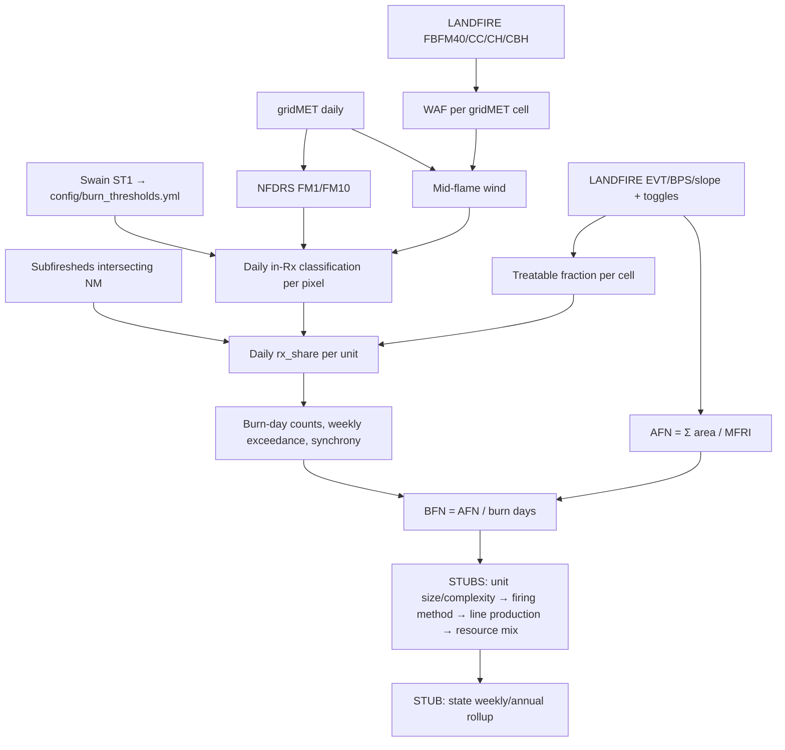

# WUS_RxResourceNeeds
Modeling the resources (personnel, quals, and equipment) needed to restore low-intensity wildfire regimes in the western United States.

> **Status (2026-10-29):** the Burn Day Model, target area, and annual Rx target (AFN/BFN) are implemented and have been run for New Mexico, 1979–2025. The unit size/complexity, firing method, line production, resource mix, and state rollup stages are **wired-in stubs with placeholder parameters**: they run end to end but their numbers are not estimates. See the [status table](#status). [`spatialanalysis_pseudocode.md`](spatialanalysis_pseudocode.md) is the statement of project intent.

## Goal and pilot scope

For each Fireshed Registry unit, estimate how much prescribed (Rx) fire is needed, how many days per year are burnable, how large and complex the burn units are, how they would be ignited and held, and what people, quals, and equipment that requires. Unit needs roll up to the state by week and year, accounting for burn-window **synchrony** (whether places are burnable at the same time) and year-to-year variability.

**Pilot:** New Mexico. Analysis units are the 3,157 Fireshed Registry 4th-edition **subfiresheds** (~25k ac) that intersect NM, kept whole (3,014 NM, plus 143 in AZ/CO/TX/OK). The 4th edition replaced the earlier "project area" layer with subfiresheds; the code calls them `project_id`.

## Repository structure

```
WUS_RxResourceNeeds/
├── _targets.R            # targets pipeline (run with targets::tar_make())
├── R/                    # pipeline functions, one file per stage
├── config/               # all parameters (YAML/CSV), see below
├── tests/                # testthat unit tests; run_tests.R runner
├── tools/                # optional parallel prefetch scripts (LANDFIRE, gridMET)
├── data/raw/             # downloads (git-ignored)
├── data/processed/       # intermediate products (git-ignored)
├── results/figures/      # PNG figures
├── results/tables/       # CSV tables
├── docs/                 # report (report.Rmd -> report.md), run notes, references
├── renv.lock             # pinned package versions
└── scripts/              # LEGACY empty numbered scripts, superseded by R/ + _targets.R
```

## Setup and running

Requires R ≥ 4.3 (built with R 4.6.1 on Windows) and internet access for first-time downloads.

1. Restore packages: `renv::restore()`
2. LANDFIRE's LFPS v2 API requires an email. Add it to your user `.Renviron`: `LANDFIRE_EMAIL=you@example.org`
3. Build: `targets::tar_make()` (inspect with `targets::tar_visnetwork()`, read results with `targets::tar_read(rx_target)`)
4. Test: `Rscript tests/run_tests.R` (195 expectations)

All settings live in `config/pipeline.yml`. The config is split into per-section targets, so changing `years` doesn't redo the 30 m LANDFIRE processing. First-time downloads can be run in parallel with `Rscript tools/prefetch_landfire.R fuels 1 2` (and `fuels 2 2`, `evt`, `bps`) and `Rscript tools/prefetch_gridmet.R 1979 2025` after `bbox`/`lf_tiles` are built.

A full rebuild with downloads cached takes about 49 minutes and uses about 7 GB of disk. Details are in [`docs/run_notes.md`](docs/run_notes.md).

## Pipeline



## Methods as implemented

### Burn-day thresholds
From Swain et al. 2023, Supplementary Table ST1. `R/extract_swain_st1.R` extracts the table from `docs/References/43247_2023_993_MOESM1_ESM.docx` to `config/swain2023_ST1.csv`. The values are encoded in `config/burn_thresholds.yml`, and `tests/testthat/test-swain.R` checks every value against the extracted table. The default is the **Forest Plans** column (`thresholds.plan_set`). Bounds are inclusive. Following Swain's Methods, afternoon conditions are used.

| Variable | Forest plans | Pipeline layer |
|---|---|---|
| Air temperature (°C) | 7.2–28.9 | gridMET daily max `tmmx` |
| Relative humidity (%) | 15–60 | gridMET daily min `rmin` |
| Mid-flame wind (m/s) | 0–4.5 | gridMET `vs` × 1.5 (afternoon) ÷ 1.15 (10 m→20 ft) × Andrews WAF |
| 1-hr FM (%) | 4–12 | NFDRS, computed |
| 10-hr FM (%) | 6–14 | NFDRS, computed |
| 100-hr FM (%) | 7.5–15 | gridMET `fm100` |
| 1000-hr FM (%) | 10–20 | gridMET `fm1000` |
| Ignition component | 20–75 | **not applied** (needs the full NFDRS spread component) |

### Weather and fuel moisture
- **gridMET:** daily data on the 1/24° grid, subset over THREDDS OPeNDAP with `ncdf4` (`R/gridmet.R`). Variables fetched: tmmx, rmin, vs, fm100, fm1000, srad.
- **1-hr and 10-hr fuel moisture** (`R/nfdrs.R`): Simard (1968) EMC regressions as used in NFDRS (Cohen & Deeming 1985). MC1 = 1.03·EMC and MC10 = 1.28·EMC, at Tmax/RHmin.
- **Fuel-level adjustment:** temperature and RH are adjusted for state of weather (+25/19/12/5 °F; RH ×0.75/0.83/0.92/1.0). Sky condition is estimated from gridMET srad ÷ FAO-56 clear-sky radiation (`nfdrs.cloud_adjust: srad`; set it to `none` to disable).

### Mid-flame wind
- **WAF equations** (`R/waf.R`, Andrews 2012 as implemented in BehavePlus):
  - Unsheltered: 1.83 / ln((20 + 0.36δ)/(0.13δ)), where δ is the Scott & Burgan fuel bed depth (`config/waf_fbfm40.csv`).
  - Sheltered: 0.555 / (√(fH)·ln((20 + 0.36H)/(0.13H))), where f = crown ratio × canopy cover / 3.
  - Sheltered applies when f ≥ 0.05 and canopy height H ≥ 6 ft.
- **Per-cell fuel inputs:** each gridMET cell uses its modal burnable LANDFIRE 2022 FBFM40, taken over treatable 30 m pixels, falling back to all burnable pixels. Canopy cover, height and base height are averaged over the same pixels. Non-burnable cells (NB91–99 only) are NA.
- **Result:** WAF ranges 0.10–0.55 (median 0.35). 19% of cells are sheltered.

### Target (treatable) area
The pseudocode's "treatable" flag (`R/target_area.R`):
- **Included:** LANDFIRE 2022 EVT names matching dry-forest patterns in `config/treatable_classes.csv`: Ponderosa Pine, Dry-Mesic Montane Mixed Conifer, Madrean (Lower Montane) Pine-Oak.
- **Excluded:** developed, spruce-fir/subalpine, pinyon/juniper, riparian/wetland and agriculture.
- **Toggles:**

| Toggle | Default |
|---|---|
| slope ≤ 25% (LF SlpD) | on |
| minimum patch 20 ac (8-connected) | on |
| wilderness exclusion | off; no wilderness layer sourced yet |

All of this runs at 30 m on a mosaic of 55 LFPS tiles (~673M cells), then aggregates to a treatable fraction per gridMET cell.

### Daily classification and rollup
- **Daily classification:** every pixel, every day: 1 if all enabled thresholds are met, 0 if not, NA if any input is missing (`R/classify.R`).
- **`rx_share`:** each unit's daily `rx_share` is the share of its treatable area that is in prescription. Cells are weighted by polygon coverage × treatable fraction × cell area (`R/rollup.R`).
- **Derived counts:** a unit burn day is `rx_share ≥ 0.5` (`rollup.burn_day_share`). Weeks are fixed 7-day day-of-year bins, with days 365/366 folded into week 52. `pixel_mean_days` is the treatable-area-weighted mean count of in-Rx days across pixels.

### Predictability and synchrony
In `R/summaries.R`:
- **Weekly exceedance:** P(≥ k burn days in week w) for k = 1–6, across years.
- **Interannual variability:** mean, SD, CV and 25th/75th percentiles of annual burn days.
- **Pairwise synchrony:** between units, as Jaccard overlap of daily burn-day series and correlation of weekly counts.

### Annual Rx target
In `R/rx_target.R`:
- **AFN** = Σ over treatable 30 m pixels of pixel area / BPS `FRI_ALLFIR`. This is TA / MFRI_eff, where MFRI_eff is the area-weighted harmonic mean.
- **BFN** = AFN / burn days, for typical (mean), poor (25th percentile) and good (75th percentile) burn-day years.

### Downstream stubs
In `R/downstream_stubs.R` and `R/state_rollup.R`, with **placeholder** parameters in `config/downstream_params.yml`:
- **Unit size × complexity:** AFN is split by WUI share and complexity share, then spread evenly across size bins 50–100 … 1601–2000 ac. Non-WUI units are 441–2,000 ac and WUI units are capped at 441 ac.
- **Firing method:**
  - Units > 1,000 ac use helicopter ignition, which halves hand-firing time.
  - Drones are used for ≥ 200 ac units of low/medium complexity, but not where heavy fuels make up ≥ 50% of the unit.
  - Otherwise, hand ignition.
- **Line production:** chains/hr by complexity.
- **Resource mix:** resources per unit-day by complexity, plus aerial ignition resources.
- **State rollup:** each unit needs resource-days ÷ mean burn days on each of its burn days. Summing that across units by day avoids double counting when burn windows don't overlap. Results are summarized by week and by good/typical/poor years (terciles of statewide burn days).

## Current results (NM, 1979–2025)

The full report is in [`docs/report.md`](docs/report.md).

| Quantity | Value |
|---|---|
| Subfiresheds analysed | 3,157 |
| Units with daily rx_share (overlap treatable gridMET cells) | 996 |
| Units with treatable area inside their boundary | 828 |
| Treatable (target) area | 3.19 M ac |
| Annual Rx need (AFN) | ~190,000 ac/yr; median MFRI_eff 20 yr |
| Mean annual burn days per unit | median 28 (IQR 22–35), interannual CV median 0.42 |
| Trend in mean annual burn days | +2.5 days/decade (p = 0.007) |
| Median pairwise burn-day Jaccard | 0.14; south and north NM are largely out of sync |

Fuel moisture binds hardest: in forested pixels, 10-hr FM is in prescription on 33% of days and 1-hr FM on 48%. The 4.5 m/s mid-flame wind cap never binds once Andrews WAFs are applied.

## Outputs

| Output | Path | Schema / content |
|---|---|---|
| Units | `data/processed/firesheds.gpkg\|layername=projectAreas` | project_id, Fireshed_ID, Fireshed_Name, Fireshed_State, area_ac (EPSG:5070) |
| gridMET cache | `data/raw/gridmet/{var}_{year}.tif` | daily layers, EPSG:4326 |
| NFDRS FM | `data/processed/nfdrs/fm1_{year}.tif`, `fm10_{year}.tif` | daily % |
| Daily in-Rx | `data/processed/burn_days/inrx_{year}.tif` | INT1U: 1 in Rx, 0 out, 255 = NA |
| Fuels / WAF | `data/processed/landfire/waf_gridmet.tif`, `fuel_by_gridmet_cell.csv` | waf, modal fbfm40, canopy means, sheltered |
| Target area | `data/processed/landfire/treatable_30m.tif`, `treatable_frac_gridmet.tif`, `project_landfire_stats.csv`, `treatable_evt_codes.csv` | 30 m mask; fraction per cell; per-unit treatable_ac, afn_ac, heavy_fuel_share, mean_slope_deg |
| Daily rollup | `data/processed/rx_share_daily.parquet` | project_id, date, rx_share |
| Synchrony | `data/processed/synchrony_pairs.parquet` | project_a, project_b, jaccard, weekly_cor |
| Tables | `results/tables/` | annual_burn_days, burn_day_variability, weekly_exceedance, rx_target_afn_bfn, thresholds_applied, and `*_STUB.csv` downstream tables |
| Figures | `results/figures/` | maps of inputs, burn-day climatology/CV/trend, exceedance, synchrony, AFN/BFN, state weekly need (stub) |
| Report | `docs/report.md` | knitr-rendered summary of the above |

## Status

| Stage | Status | Notes |
|---|---|---|
| Scaffolding (renv, targets, testthat) | Implemented | 195 test expectations |
| Swain ST1 thresholds → config | Implemented | verified against extracted ST1 |
| Study area + subfiresheds | Implemented | |
| gridMET sourcing | Implemented | OPeNDAP via ncdf4 (climateR not needed) |
| NFDRS 1-hr / 10-hr FM | Implemented | srad-based state-of-weather approximation |
| LANDFIRE sourcing + WAF grid | Implemented | LF2022 fuels/EVT, LF2020 BPS/SlpD |
| Daily in-Rx classification | Implemented | |
| Target-area mask | Implemented | wilderness toggle needs a layer |
| Unit daily rollup | Implemented | |
| Predictability and synchrony | Implemented | |
| Full 1979–2025 run | Done | see docs/run_notes.md |
| Annual Rx target (AFN/BFN) | Implemented | |
| Unit size/complexity, firing, line production, resource mix | **Stub** | placeholder parameters |
| State rollup + report | **Stub** (logic implemented, inputs placeholder) | docs/report.md (knitr; Quarto not installed) |

## Known limitations

- No bias correction of gridMET against RAWS.
- The ignition component threshold isn't applied.
- The NFDRS state-of-weather adjustment is an approximation from daily srad; the breakpoints are in `nfdrs.sow_breaks`.
- Mid-flame wind uses Andrews WAFs plus Swain's ×1.5 afternoon factor. Swain instead used a flat 0.4 reduction, so wind is effectively non-binding here.
- Treatable-class patterns are name-based. Review `data/processed/landfire/treatable_evt_codes.csv`.
- Wilderness exclusion isn't sourced. WUI isn't sourced either (the pseudocode cites wildfirerisk.org), so the WUI share is a placeholder.
- The minimum-patch filter uses GDAL sieve (see run notes). Patches crossing LANDFIRE tile seams are handled on the mosaic.
- All downstream parameters are placeholders. State need figures show only that the pipeline works.

## Data sources

| Input | Source |
|---|---|
| gridMET (Abatzoglou 2013) | https://www.climatologylab.org/gridmet.html |
| LANDFIRE LF2022 FBFM40, CC, CH, CBH, EVT; LF2020 BPS, SlpD (LFPS v2 via `rlandfire`) | https://www.landfire.gov/ |
| Fireshed Registry 4th ed. (Evers et al. 2025), RDS-2020-0054-4 | https://doi.org/10.2737/RDS-2020-0054-4 |
| Swain et al. 2023, Commun Earth Environ 4:340, Table ST1 | https://doi.org/10.1038/s43247-023-00993-1 |
| Andrews 2012, RMRS-GTR-266 (WAF) | https://www.fs.usda.gov/research/treesearch/40651 |
| Scott & Burgan 2005, RMRS-GTR-153 (fuel bed depths) | https://www.fs.usda.gov/research/treesearch/9521 |
| Cohen & Deeming 1985, PSW-GTR-82 (NFDRS) | https://www.fs.usda.gov/research/treesearch/27315 |
| State boundary (Census cartographic, via `tigris`) | https://www.census.gov/geographies/mapping-files.html |
